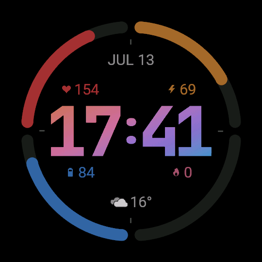
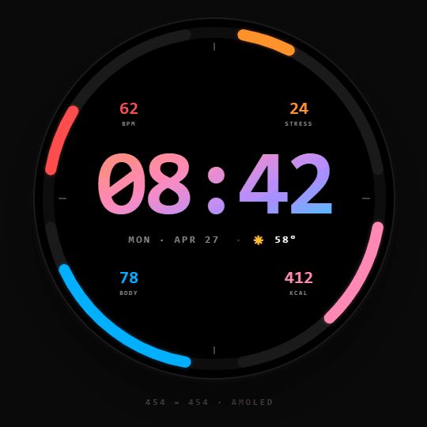

# Arches Watch Face — Connect IQ (Monkey C)

A 454×454 round AMOLED watch face for Garmin watches (Forerunner 965/970, Fenix 8, Epix Pro, Venu 3/4 and others — see `manifest.xml`):

- **4 arc gauges** around the bezel, each showing a fixed metric
  - top-left (red) — heart rate
  - top-right (orange) — stress
  - bottom-left (blue) — body battery
  - bottom-right (rose) — calories
- **Date** row above the time (e.g. `APR 28`; in 12-hour mode `APR 28 · PM`)
- **Time** in the device's 12/24-hour format, displayed as pre-tinted bitmap digits (orange → rose → purple → blue)
- **Weather** below the time — a condition icon plus temperature (e.g. `⛅ 18°`); clear skies show a moon after sunset
- **Always-on (low power) mode** with AMOLED burn-in protection

## Screenshots


|  |  |
|:-:|:-:|
| Current implementation | Envisioned design |


## Project layout

```
monkeyc/
  manifest.xml                    Connect IQ app manifest (11 round 454×454 AMOLED devices, minApi 4.2.0)
  monkey.jungle                   Build config (source + test paths)
  source/
    ArchesWatchFaceApp.mc         AppBase entry point
    ArchesWatchFaceView.mc        All rendering logic
    ArchesLogic.mc                Pure helpers (slot values, 12/24h, temperature)
  test/
    ArchesLogicTest.mc            Unit tests for ArchesLogic
  resources/
    strings/strings.xml           App name ("Arches")
    drawables/drawables.xml       56 bitmap registrations
    images/
      launcher_icon.png           65×65 launcher icon (default size)
      hr.png, stress.png,
        body.png, calories.png    Arc metric icons (flat, pre-tinted per slot)
      weather_*.png               11 weather condition icons (incl. night moon)
      h1_0..h1_9.png              Hours tens digit (orange-tinted)
      h2_0..h2_9.png              Hours units digit (rose-tinted)
      colon_colon.png             Colon separator (purple-tinted)
      m1_0..m1_9.png              Minutes tens digit (purple-tinted)
      m2_0..m2_9.png              Minutes units digit (blue-tinted)
  resources-icon60/, resources-icon70/
                                  Native 60×60 / 70×70 launcher icons (see monkey.jungle)
  tools/
    gen_arc_icons.py              Regenerates the pre-tinted arc metric icons
    gen_launcher_icon.py          Draws the launcher icon at a given size
    gen_moon_icon.py              Draws the night (moon) weather icon
```

## Complications

The four arcs are backed by the **Connect IQ Complications** framework. The face
reads four complications (0–3), each with a fixed type, bezel position and accent
color:

| Slot | Position | Color | Complication | Icon |
|---|---|---|---|---|
| 0 | top-right | orange | Stress | stress |
| 1 | bottom-right | rose | Calories | kcal |
| 2 | bottom-left | blue | Body Battery | body |
| 3 | top-left | red | Heart Rate | hr |

The slots are **not user-configurable**: type, color and icon are fixed per position.
`ArchesLogic.compMax()` supplies the full-scale value per type (HR 200, calories 5000,
stress and body battery 100) so each arc fills proportionally. Complications are read
via `ArchesLogic.safeGetComplication()`, which returns `null` instead of throwing when
a device doesn't provide a type, so a missing metric shows `--` instead of crashing.

Temperature and the weather-condition icon come from their own dedicated
complications (`CURRENT_TEMPERATURE` and `CURRENT_WEATHER`).

## Architecture

### ArchesWatchFaceView.mc

All drawing is done in a single `WatchFace` subclass. Key sections:

| Section | What it does |
|---|---|
| `initialize()` | Loads the digit resource tables and allocates the six complication IDs (guarded by `Toybox has :Complications`) |
| `onLayout()` | Computes `scale`, `arcRadius`, `arcStroke`, `labelRadius` from actual screen size |
| `readComplications()` | Reads the four arc complications each frame |
| `readTemp()` | Reads the temperature complication (always Celsius); converts to °F if the device uses statute units, rounding after converting |
| `readWeatherIcon()` | Maps `CONDITION_*` to a weather icon via `ArchesLogic.weatherIconFor()`; moon instead of sun at night |
| `isNightNow()` | Sunrise/sunset at the weather location (refreshed hourly); falls back to 20:00–06:00 |
| `drawArcs()` | Four progress arcs over a dim track, with filled-circle endcaps for a rounded look |
| `drawThickDesignArc()` | Single drawArc pass; strokes above `SPLIT_THRESHOLD` fall back to two overlapping passes (firmware seam workaround) |
| `drawCardinalTicks()` | Short divider ticks at the four arc gaps |
| `drawTime()` | Renders five bitmap images (h1, h2, colon, m1, m2); each position has its own tint. Bitmaps are cached and reload only when the minute changes |
| `drawDateWeatherRow()` | Date string (above time) and temperature + weather icon (below time) |
| `drawArcLabels()` | Metric icon + formatted integer value, above/below center per slot |
| `drawLowPower()` | Minimal always-on rendering (see below) |

### Always-on mode & AMOLED burn-in protection

`onEnterSleep()` / `onExitSleep()` toggle a low-power flag; in low power `onUpdate()`
delegates to `drawLowPower()`, which draws only a dim `HH:MM` string (plus a small AM/PM in 12-hour mode) and shifts it
around a 5×5 pixel grid over 25 minutes so no pixel stays continuously lit.

In full-power mode several measures reduce image retention:

- All arc accent colors are dimmed to ~65% of the original design values (kept in
  sync with `BRIGHTNESS` in `tools/gen_arc_icons.py`).
- The cardinal ticks drift radially outward by 0–4 px on a 5-minute cycle.
- The arc value labels drift vertically by ±2 px on a 5-minute cycle, mirrored
  about the screen center.

### Why pre-tinted bitmap digits?

Monkey C has no gradient fill for text. Each digit image is pre-colored at design
time, giving the visual impression of an `orange → rose → purple → blue` gradient
across the clock face with no runtime cost.

## Required permissions

Declared in `manifest.xml`:

| Permission | Used for |
|---|---|
| `ComplicationSubscriber` | Reading the arc, temperature, and weather complications |

## Building

1. Install the [Garmin Connect IQ SDK](https://developer.garmin.com/connect-iq/sdk/) and the VS Code **Monkey C** extension.
2. Open the `monkeyc/` folder as the project root in VS Code.
3. Run **Monkey C: Build for Device** and select a device (e.g. `fr965`).
4. Sideload the resulting `.prg` via the Connect IQ desktop app, or run it in the simulator.

The layout scales off screen width, so any 454×454 round AMOLED device can be added
to `<iq:products>` in `manifest.xml`.

### Running the unit tests

With the simulator open:

```
monkeyc -f monkey.jungle -d fr965 -y <developer_key.der> -o test.prg -t
monkeydo test.prg fr965 /t
```

(In Git Bash, prefix `monkeydo` with `MSYS_NO_PATHCONV=1` so `/t` isn't rewritten.)

## Notes on fidelity vs. the HTML design

| HTML feature | Monkey C approach |
|---|---|
| Smooth anti-aliased arcs | `dc.setAntiAlias(true)` + filled circles for rounded endcaps |
| Wide arc strokes | Single pass at 24px; two-pass fallback above `SPLIT_THRESHOLD` |
| CSS `linear-gradient` time text | Pre-tinted bitmap digit images per position |
| Glow under arcs | Omitted — requires offscreen buffers and hurts AMOLED battery |
| `oklch()` colors | Approximated to nearest sRGB hex, then dimmed to ~65% for burn-in |
| Sun / weather glyphs | `CONDITION_*` constants mapped to 10 weather PNG icons |
| Stress / body / calorie values | Coerced via `.toNumber()` / `"%d"` to avoid `35.000000` strings |

## Before publishing

- `manifest.xml` `id="..."` is the permanent app ID — never change it after the first
  store upload, and always sign with the same developer key.
- Launcher icon: 65×65 default; native 60×60 and 70×70 versions for the devices that need them, wired in `monkey.jungle`. Regenerate with `tools/gen_launcher_icon.py`.
- App store name, description, and screenshots.

## AI assistance

The visual design and all Monkey C source code were generated with the assistance of [Claude](https://claude.ai) (Anthropic) and [Gemini](https://gemini.google.com) (Google). Human authorship covers the design brief, layout decisions, and iterative review.
